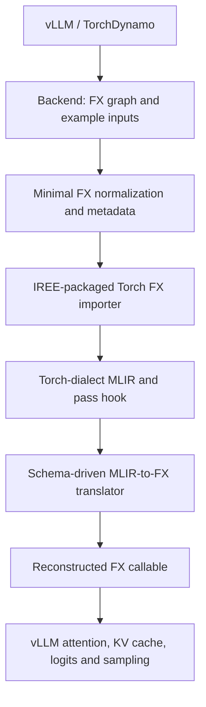

# vLLM FX–MLIR–FX Compilation Plugin

**Status:** Proposed; pending human approval
**Scope:** CPU-first semantic round trip, not an implementation plan

## Intent and evidence

Build an out-of-tree backend that imports a TorchDynamo FX graph into MLIR, runs a controlled pass pipeline, reconstructs executable FX, and returns a callable. Develop the basic round trip first; the first major integration target runs it through vLLM, which retains its engine, scheduler, attention, forward context and KV cache.

The user supplied a prototype and reports that it runs this round trip through vLLM. It uses `DYNAMO_TRACE_ONCE`, IREE's packaged Torch FX importer, normalization of a small set of raw Dynamo calls, an importer type extension, and an MLIR-to-FX visitor. That is evidence for a practical starting path, not proof that its restricted mappings preserve every graph. The prototype was supplied in the conversation, not found in the repository. This design review did not execute it or install its dependencies.

Upstream details below use vLLM **0.34.0** and its CPU PyTorch **2.14.0+cpu** requirement as a reference [1, 2]. The prototype's dependency versions were not provided. Neither this reference nor the inspected importer sources establish a tested common version tuple.

## 1. Goals and non-goals

### Goals

- Invoke the plugin through vLLM's normal compilation configuration and the standard PyTorch backend contract, without modifying vLLM.
- Make `SimpleVllm` and `SimpleVllmForCausalLM` from `python/tests/models/simple_vllm_model.py` the required first end-to-end vLLM integration target, including their **real** `vllm.Attention`, with the same graph arguments, outputs, and observable custom-operator behavior, execution order, and runtime dependencies as the unmodified execution.
- Preserve high-level operations where their semantics are known, including an actual `torch.aten.linear` in the imported MLIR for the fixture's linear projection. Do not gratuitously decompose it into matrix multiplication and addition.
- Represent Dynamo's symbolic values, ordinary Python/FX call forms, dispatcher operators, vLLM custom operators, and live opaque runtime objects without baking in example values.
- Make operator handling reusable and schema-driven where possible. Model-specific node sequences, hardcoded layer names, and per-model graph translators are not the architecture.
- Provide a straightforward MLIR pass hook without requiring optimizations or a new dialect in the first milestone.
- Establish a required Linux x86-64 CPU end-to-end test and keep the translator device-neutral for later CUDA and other platforms.

### Non-goals

- Replacing vLLM's attention, KV cache, scheduler, model runner, logits processing, sampler, or distributed execution.
- Training, backward compilation, quantization, distributed/tensor-parallel models, CUDA graphs, and native MLIR code generation in the first milestone.
- Developing MLIR effect models, alias analysis, effect tokens, or mutation-aware optimization infrastructure. Effect-aware MLIR optimizations depend on a separate side-effect and mutation semantics workstream and are not deliverables or prerequisites for the initial implementation.
- Supporting every possible PyTorch program, tensor subclass, higher-order operator, or vLLM architecture initially. Unsupported constructs must fail explicitly, not silently run an untransformed graph.
- Claiming speedups, full vLLM piecewise-compilation feature parity, a stable serialized MLIR format, cross-process object serialization, or compatibility with untested dependency versions.

### Required reference fixture

The first major vLLM integration test must use the existing [`python/tests/models/simple_vllm_model.py`](../python/tests/models/simple_vllm_model.py) classes `SimpleVllm` and `SimpleVllmForCausalLM`. Do not substitute a different simplified model or a standalone attention implementation.

`SimpleVllm`, decorated with `@support_torch_compile`, takes `input_ids`, `positions`, and optional `inputs_embeds`. With hidden size `H` and `N` attention heads, its forward computation is:

1. Use `inputs_embeds` when supplied; otherwise use `nn.Embedding(vocab_size, H)` on `input_ids`.
2. Apply the bias-free fused `nn.Linear(H, 3 * H)` QKV projection and split it with `chunk(3, dim=-1)`.
3. Pass Q, K, and V to the actual vLLM `Attention`, with `N` query and KV heads, head size `H // N`, and scale `(H // N) ** -0.5`.
4. Apply the bias-free output projection `nn.Linear(H, H)` and return the hidden states.

`SimpleVllmForCausalLM.forward` delegates to `SimpleVllm`; its separate `compute_logits` applies a bias-free `nn.Linear(H, vocab_size)` language-model head. `positions` is accepted and forwarded but not used by the core computation; `intermediate_tensors` is an interface argument. The logits head remains outside the compiled model-forward graph.

The end-to-end harness may choose smaller dimensions, deterministic weights, a local configuration, and registration or weight-loading scaffolding. These are test concerns, not compiler architecture: they must not modify the fixture's computational structure or replace vLLM attention. Run the same fixture with and without the plugin for the acceptance comparison below.

## 2. Approaches and integration decision

| Approach | Decision | Trade-off |
| --- | --- | --- |
| Direct Dynamo backend, IREE-packaged Torch importer, and a schema-driven reverse translator | **Proposed.** | Closest to the working prototype; reuses Torch dialect and PyTorch execution. The raw importer needs a narrow adapter and an explicit supported subset. |
| Direct upstream Torch-MLIR importer | Alternative distribution of the same approach. | Similar importer and dialect; useful if its tested versions are a better fit. Do not mix its MLIR bindings with IREE's. |
| vLLM `VLLM_COMPILE`/`CompilerInterface` adapter | Later option. | Could retain vLLM's piecewise compiler, but uses an internal cache/compiler contract, may split attention out, and vLLM 0.34 CPU rewrites mode 3 and replaces the backend [5, 6]. |
| Export/AOTAutograd before importing | Not the initial path. | Normalizes more operators but can decompose `linear`, functionalize mutation, and change input/output conventions or freeze state [3]. |

### vLLM configuration

The prototype uses the following direct-backend path; retain it as the primary vLLM integration target in M2:

```python
CompilationConfig(
    mode=CompilationMode.DYNAMO_TRACE_ONCE,
    backend="ml_compiler.vllm_backend.compile_fx",
)
```

In vLLM 0.34, mode 2 calls the backend for the `@support_torch_compile`-decorated model forward, and a dotted name is resolved to the backend function [5, 7]. The prototype registered a short name in the current process; the packaged plugin should also expose a `torch_dynamo_backends` entry point so a name or dotted path works in workers [9]. Model registration is separate: use `ModelRegistry` or a `vllm.general_plugins` entry point as appropriate [10].

**Guard trade-off:** vLLM's trace-once mode normally drops Dynamo guards. The plugin must not specialize symbolic sizes from example inputs or add assumptions, but it cannot restore guards that vLLM removes. Validate the target's prefill/decode sizes under the selected vLLM configuration; use vLLM's unbacked or guard-evaluation options when compatible, or choose stock mode when ordinary guard/recompilation behavior is needed [8]. Supported behavior is limited to the tested shape domain and the selected vLLM guard policy; successful tests do not make guard dropping universally safe.

In trace-once mode, vLLM documents that an argument captured as `None` should remain `None` for that model instance [7]. Capture the token-ID and `inputs_embeds` branches separately; use stock mode if optionality must change under ordinary Dynamo guards.

`STOCK_TORCH_COMPILE` is a supported direct-backend alternative and should receive a focused integration test. In vLLM 0.34 the runner compiles the outer model in that mode, while the inner decorator does not independently compile it [7]. Both direct modes bypass vLLM mode-3 piecewise partitioning, compilation ranges, custom Inductor passes and piecewise cache. They do not replace the vLLM runtime.

### PyTorch and Inductor execution

M1 returns the reconstructed `GraphModule.forward` callable for standalone PyTorch tests; M2 uses that callable in vLLM. This runs PyTorch operations directly and provides the simplest correctness baseline; it is not an implicit call to Inductor. Logits and sampling still execute normally in vLLM.

A subsequent explicit Inductor mode will call `torch._dynamo.lookup_backend("inductor")(rebuilt_gm, example_inputs)` and return that backend's callable [9]. It must not call `torch.compile` on the rebuilt module and recapture the model. The adapter must account for Inductor owning or modifying its graph, preserve its actual callable convention, pass only explicitly supported options, and validate behavior through real vLLM execution. It must not claim to inherit vLLM's Inductor configuration, custom passes, partitioning, or cache. Direct FX and Inductor are independently selected modes; compilation failure is an error, never a silent fallback from one to the other. The Inductor path is not a milestone-1 acceptance requirement.

## 3. Architecture and component contracts



The graph passed to the backend is the compilation unit. It may be a variant of the model forward, and its inputs and output need not match the model's source-level signature. For the supplied model, the logits head is called by vLLM outside this captured forward graph; its logits and sampling are still part of the end-to-end comparison [8]. An unused `positions` argument, for example, need not appear as an FX placeholder.

The proposed interfaces are:

| Component | Contract |
| --- | --- |
| `compile_fx(gm, example_inputs, **backend_options)` | Accept a `torch.fx.GraphModule` and `Sequence[object]`, not just real tensors. Return a callable with exactly the behavior and calling convention of `gm.forward`. Reject unsupported backend options explicitly. The standard vLLM example above supplies no special options. |
| FX normalization | Convert supported raw Dynamo callables and methods into importer-compatible forms without changing their behavior. Work on a structural copy; do not deep-copy model state or execute the graph. |
| `import_fx` | Use IREE's packaged `FxImporter` and a small adapter for needed types and operations. Produce a Torch-dialect MLIR module plus per-compilation metadata needed for reconstruction. |
| `run_passes` | Validate the module and run the configured pipeline. Initially the pipeline has no transformations and leaves potentially stateful operations unchanged. |
| `rebuild_fx` | Visit MLIR operations in order, resolve registered operators through their schemas, rebuild FX arguments/results and output, then run `graph.lint()` and `GraphModule` code generation. |

A per-compilation context owns the MLIR context/module while needed, a stable mapping for in-process callable/object bindings, the original FX root for live attribute lookup, and metadata/codegen information needed to reconstruct the graph. The returned callable retains the bindings it needs even after the MLIR module is released. Runtime placeholders are supplied on every invocation, not captured from `example_inputs`. No process-global table may accidentally share bindings between models, workers, or concurrent compilations.

`example_inputs` and node metadata may contain real tensors, fake tensors, symbolic scalars, and opaque objects. Metadata is optional analysis information: the compiler must not read tensor contents, run a real kernel, or execute a user graph to discover a type. Missing metadata is distinct from a known Python `None`.

### Representation and lifetime

The initial IR is the Torch dialect produced by the importer: for example, `torch.aten.linear` and `torch.operator` for a registered vLLM custom operator. The module and its SSA operands/results carry the operation sequence and dataflow. A small per-compilation metadata record preserves information the importer does not round-trip by itself: original call form where needed, argument/keyword and output structure, live attribute bindings, symbolic metadata, and source locations. It is not a copy of the original FX program to replay. If an operation changes, metadata must still match it or reconstruction fails.

Keep weights and other mutable objects as live graph inputs or bindings rather than frozen tensor literals. Opaque runtime values, including the prototype's `FakeScriptObject`/vLLM layer-name case, are represented with an appropriate opaque type such as `!torch.any`; the actual runtime object is passed through at invocation. Do not serialize it or capture a warmup context. The returned callable owns any binding objects it needs, separately for each compilation and worker.

The initial pipeline performs **no transformations**: it does not reorder, eliminate, or otherwise change potentially stateful operations. Reconstruct FX by walking the imported block in program order, retaining the custom-operator calls and their runtime dependencies. Effect-aware MLIR optimizations are a future integration dependency on the separate side-effect and mutation semantics workstream, not a deliverable or prerequisite here.

## 4. FX → MLIR frontend

Use the IREE-packaged `iree.compiler.extras.fx_importer.FxImporter` as the first frontend, as in the supplied prototype. IREE packages Torch-MLIR importer sources when Torch input support is enabled [13]; this does **not** require using IREE native compilation or its runtime. Keep importer-specific code in one adapter so a compatible upstream Torch-MLIR distribution can replace it if needed.

The low-level graph import APIs assume a functionalized/stateless graph; raw Dynamo graphs are not generally that form. The prototype shows a useful case that works despite this limitation. Adapt only the constructs needed for the supported subset, validate the resulting MLIR, and fail when equivalence cannot be established. Importer hooks, `ContextCache`, fake-object types and private fields are version-sensitive. Use the same IREE binding/context family throughout; do not combine independently built MLIR libraries [4, 13].

Some importer versions remove `aten._assert_async.msg` or rewrite operations during import [4]. The adapter must prevent such behavior-changing rewrites or reject affected graphs, and must not silently lose vLLM custom calls or their dependencies.

### Normalization policy

1. Inspect every FX node before import so unsupported nodes cannot be silently skipped. Preserve graph inputs, outputs, call ordering and live state. Copy graph structure before normalization because both local rewrites and the upstream importer may mutate it.
2. Resolve a registered `OpOverload` from its schema. Normalize an overload packet only when its overload is unambiguous; otherwise preserve its runtime dispatch where supported or report it. Do not assume every packet means `.default`.
3. Use a small registry of general, tested rules for raw builtins and methods that the importer cannot accept directly. Start with the demonstrated forms of linear, embedding, `empty`, `view`, `chunk`, `getitem`, and `torch.Size`, while handling their actual arguments. Do not key rules to model layers or node names.
4. Preserve semantics when a Python API and ATen schema differ. For example, `F.embedding` orders its inputs differently and its options must not be replaced with fixed defaults unless equivalent. `Tensor.chunk` returns a tuple of views and may return fewer chunks than requested [14]; preserve the original result and view behavior. Only simplify `torch.Size` to a list when the consumer cannot observe the difference.
5. Use fake/example metadata for type information without evaluating symbolic hints or running real tensors. Distinguish missing metadata from a real `None`. Extend the importer for opaque objects and necessary aggregate types; do not freeze live parameters or context objects.

Do not invoke AOTAutograd, functionalization, `torch.export`, decomposition, or default FX dead-code elimination as a shortcut; these can change the captured graph [15]. If a method, builtin, live attribute or module call cannot be imported and reconstructed without changing behavior, fail with its node and target rather than silently dropping it.

### Types and symbolic shapes

- Preserve rank and dtype when known; otherwise use an unknown type rather than a guessed example value. Preserve device, layout, and stride information where required by the captured calls, and reconstruct view operations without changing their behavior. A device is not silently rewritten to CPU; CPU is the first tested execution target.
- Retain `SymInt`, `SymFloat`, and `SymBool` graph inputs and executable shape arithmetic as SSA dependencies. Preserve repeated symbol relationships and the enclosing Dynamo guard regime. `?` dimensions alone are not equality constraints and an example's concrete hint is not a legal specialization.
- The plugin must not add shape assumptions or discard guards. Stock mode retains ordinary Dynamo guards; trace-once mode follows vLLM's guard policy described above. A supported symbolic graph must work across multiple values within its valid domain.
- Keep metadata describing symbolic expressions when available, without requiring the importer's limited affine symbolic-shape encoding to represent every PyTorch expression. Preserve exact executable symbolic operations rather than evaluating `int()`, `bool()`, or Python `eval()` on symbolic values.

## 5. MLIR → FX reconstruction

No investigated importer supplies the reverse translator. Implement a visitor for the supported Torch-dialect operations and the metadata captured during import:

1. Walk the actual MLIR SSA dataflow and operations in block order. Reconstruct constants, list/tuple construction and unpacking, `func.return`, `torch.aten.*`, and `torch.operator`; reject unknown operations or unsupported regions. Metadata may restore a call convention, but must not cause an altered MLIR operation to be silently replaced by the original FX node.
2. Resolve registered operations by namespace, name and exact overload using the PyTorch dispatcher. Use schemas to bind positional and keyword-only arguments, defaults and returns rather than maintaining a model-specific table. Preserve an overload packet's runtime dispatch unless selecting an overload is proven equivalent. Isolate `OpOverload._schema`, `torch._ops` and importer-internal dtype maps behind adapters because they are not stable APIs.
3. Preserve omitted versus explicit defaults where observable, including `None`; `has_default_value()` distinguishes a missing default from a `None` default. Decode dtype, device, layout and memory-format values according to the formal schema and the selected importer version, not just argument names.
4. Preserve Python scalar types, symbolic values, shapes, lists, tuples, dictionaries, named tuples, multiple results and a single list-valued result. The FX graph output must match the captured callable's actual nesting and calling convention, not always be coerced to a tuple. Preserve repeated references and view behavior.
5. Emit zero-result or `None`-result operators exactly once, even if they have no data users; if the FX result is used, reconstruct its Python `None` value as well. Resolve custom vLLM operators through the registered dispatcher and pass all original arguments, including opaque objects and keyword-only arguments.
6. Preserve live `get_attr`/module bindings when supported rather than copying or freezing mutable values. A per-call binding can resolve a rebound attribute; otherwise reject that graph form. Do not snapshot fake objects, model weights, or the current forward context.

Source maps should identify the FX node and original stack location where available. An unsupported operation, region, type, unresolved binding, ambiguous conversion, or schema mismatch fails compilation with phase, graph/node, target/overload and expected/observed contract. Diagnostics must not dump tensor contents or checkpoint data by default. MLIR and binding tables are trusted in-process compiler artifacts, not a mechanism to deserialize arbitrary objects or evaluate source strings.

## 6. Custom operators and runtime dependencies

Reconstruct vLLM custom-operator calls in their captured order, with the same arguments and dependencies, including calls with no result. Preserve their observable behavior rather than replacing them or treating them as removable.

In vLLM 0.34 CPU attention, `unified_kv_cache_update` supplies a dummy dependency to `unified_attention_with_output`, which writes an output tensor [16]. Preserve both calls, their order, the dependency, the output buffer, and the live runtime context. A layer name may be a hoisted opaque object rather than a string [17].

The round trip preserves the captured operations and their tensor and object references; it does not require the plugin to add an MLIR side-effect model, alias analysis, or effect tokens. The initial pass pipeline leaves potentially stateful operations unchanged.

## 7. MLIR passes and native integration

Expose a small pass-pipeline hook between import and reconstruction. Milestone 1 verifies the MLIR module but enables no transforming passes: potentially stateful operations are not reordered, eliminated, or otherwise changed. No new MLIR effect models, alias analysis, effect tokens, or mutation-aware optimization infrastructure are required by this project.

Effect-aware MLIR optimizations are a future integration dependency on the separate side-effect and mutation semantics workstream, not a deliverable here. Any later integration must use that workstream's established semantics before enabling such transformations [12].

Python is sufficient for the initial adapter and translator. Future C++ passes can use the existing CMake/nanobind skeleton, but must use the same compatible MLIR distribution/context as the importer; avoid assuming that independently packaged MLIR libraries share an ABI [18].

## 8. Initial supported subset and failure policy

| Category | Required initially | Boundary |
| --- | --- | --- |
| Model operations | M1 supports embedding, linear, chunk/getitem, view/reshape, allocation and shape/scalar operations. M2 supports the actual vLLM custom ops in the reference fixture's capture. | Reusable schema handling and small general normalization rules, not model-specific graph matching. Unsupported methods or call forms fail explicitly. |
| Inputs and outputs | Dense CPU tensors, symbolic dimensions and scalar values, optional values, dtype/device, lists/tuples, graph output structure, and opaque vLLM runtime objects. | Do not infer symbolic values from examples or stringify Python objects. Preserve live attributes where supported; reject unsupported higher-order control flow or object forms. |
| Custom operators | Preserve the captured calls, their original order, runtime dependencies, and observable behavior, including output-buffer writes. | The initial pipeline does not transform potentially stateful operations; effect-aware optimizations depend on the separate workstream. |
| Execution | M1 executes the reconstructed FX callable in PyTorch; M2 uses it with the selected vLLM guard policy. | CUDA, Inductor, vLLM piecewise compilation, persisted compiler caches and more model architectures need their own validation before being claimed. |

Unsupported input or MLIR must fail with an actionable diagnostic. Do not silently return the original FX graph, suppress compilation errors, or replace attention. Preserve exact graph calling/output conventions for supported inputs.

## 9. Testing and acceptance

Tests target behavior, not the prototype's hardcoded operator table. Use pytest in the existing Python test layout. The core skeleton tests must remain runnable without optional compiler dependencies. The M1 component job must provide PyTorch and the importer; the M2 CPU integration job must additionally provide vLLM and fail rather than silently skip. Use local fixtures and no network.

The tests below check observable behavior; this project does not build a comprehensive side-effect analysis test framework.

### Compiler-component acceptance (M1)

1. Import and reconstruct embedding and linear, assert `torch.aten.linear` survives, and compare executable outputs. Cover non-default arguments; unsupported options must fail explicitly, never be replaced with defaults.
2. Exercise exact overloads and packets; positional, keyword-only, optional and default arguments; scalars, dtype/device and shape values; builtins and tensor methods. Test supported live attributes and opaque objects. Include an optional FX placeholder used with `None` and a tensor when its graph contract permits both, as distinct from operator defaults.
3. Compare output structure and view behavior for tuples/lists, a multi-result operator, a list-valued result, `None`, and `chunk` views, including a case returning fewer chunks than requested.
4. Capture symbolic shape arithmetic and run the same reconstructed graph on multiple valid token counts. Exercise size one and zero where permitted; distinguish legitimate guard recapture from actual symbolic reuse.
5. Round-trip a focused example with two registered CPU custom operators: one writes an output buffer and returns `None`, and the other reads it. Compare the output and call order with the original graph, and verify that importing does not run the real kernels.
6. Test that changing a supported MLIR constant changes the reconstructed graph's output. An unsupported FX or MLIR operation, including an assertion the importer would otherwise drop, must be preserved or produce a useful error rather than run an unmodified fallback.

### Reference-model vLLM engine acceptance (M2)

Use the required `SimpleVllmForCausalLM` fixture identified above, preserving its computational structure and real `vllm.Attention`. Register it with vLLM normally and supply a local small configuration, deterministic weights and any fixture-only loading code needed by the selected vLLM version. The required runner is Linux x86-64 with vLLM's CPU prerequisites. A starting configuration is one layer, vocabulary 128, hidden size 64, two heads of size 32, FP32 and block size 32 [19]. Token-ID prompts avoid a remote model or tokenizer. The prototype's dummy-weight setup can be a smoke test; the comparison fixture must use identical, nontrivial weights.

Run the reference with vLLM compilation disabled and the plugin in a separate equivalent engine, using the same device, weights and input sequence. The plugin run uses the prototype's trace-once configuration with `VLLM_DISABLE_COMPILE_CACHE=1` and `VLLM_USE_AOT_COMPILE=0` set before importing vLLM. Also exercise stock mode once to validate the documented guarded alternative. Record the resolved mode/backend; the plugin must actually be invoked, not merely configured.

The required test establishes that:

1. The model is registered and executed by the normal vLLM engine with real CPU attention.
2. The backend imports its FX graph; MLIR contains high-level linear and the captured vLLM attention/cache operations; the rebuilt callable runs for actual requests, not only warmup.
3. Prompt lengths include one and several larger token counts, and generation includes at least four tokens so prefill and multiple decode steps are exercised. Instrument the rebuilt callable in the test to record actual token dimensions during requests, and require the same trace-once graph to execute at size one and a larger size; prompt length alone does not establish this. Compare hidden states or logits and generated token IDs/log probabilities against the unmodified path, using deterministic greedy sampling. Prompt and output log probabilities can provide per-step observations without a remote tokenizer.
4. Exercise attention and the existing KV cache through prefill and decode. Use different prefixes with the same suffix and weights chosen so at least one compared reference value differs by more than twice its applicable absolute-plus-relative tolerance; compare both plugin continuations with their reference values. The focused component test checks custom-operator order and output-buffer behavior without replacing vLLM attention.
5. Capture and compare the model's `inputs_embeds` branch in a separate model instance. For the vLLM test, use `enable_prompt_embeds=True` and a local `prompt_embeds` tensor [21]; compare it with an uncompiled engine using the same embeddings and weights. Do not switch a `None`-specialized trace-once input in place.

For vLLM 0.34, the x86 CPU runner inherits the model runner that honors `enable_prompt_embeds`; the standalone CPU runner only selects `inputs_embeds` for multimodal inputs [22]. Do not assume the embedding test covers other CPU runners without testing their actual behavior.

For the same FP32 CPU backend, start with `rtol=1e-4`, `atol=1e-5` and exact integer/structure comparison. Different kernels, devices or lower precision can require justified tolerances; near-tied logits can change greedy tokens even when numerical differences are small. Compare logits/log probabilities and use a fixture with a clear selection margin before requiring exact token equality.

Together the component and engine tests cover model registration, plugin selection, import, high-level/custom operators, reconstruction, execution, varied prefill/decode token counts, numerical agreement, and custom-operator behavior and runtime dependencies.

### Later tests

Validate later Inductor delegation and additional devices against real vLLM execution, including focused custom-operator and variable-token tests. Add model architectures using representative real captures, not architecture-specific graph walkers. vLLM piecewise integration, distributed execution, quantization, AOT/boxed calling conventions and persisted caches need their own tests before support is claimed. Effect-aware MLIR optimization testing belongs to the separate workstream.

## 10. Dependencies and implementation milestones

- **M0 — pin the component stack.** Identify a compatible PyTorch, IREE compiler/importer and Python combination for M1. Start from the prototype's environment when available; the version tuple is not included in the supplied code. The current repository's base Pixi environment uses Python 3.14 and need not be replaced just to add an optional plugin environment. A vLLM installation is not required for M1.
- **M1 — basic FX round trip and operators.** Develop the reusable normalization/type adapter, schema-driven reverse translation, no-transform pass hook and standalone PyTorch/Dynamo backend. Pass the compiler-component tests above for ordinary and focused custom operators, symbolic values and output conventions. This milestone does not require the vLLM engine or the reference-model integration test.
- **M2 — first vLLM integration.** Determine a compatible Linux x86-64 CPU vLLM tuple, then register and execute the existing `python/tests/models/simple_vllm_model.py` fixture through the normal vLLM engine and the plugin. Pass the reference-model acceptance test above, including real attention and prefill/decode comparison. This is the first major end-to-end integration target.
- **M3 — Inductor and more models.** Add explicit Inductor delegation and compare its behavior with real vLLM execution. Extend supported operators from actual captured graphs, not model-specific walkers.
- **M4 — additional devices.** Validate CUDA and other devices with representative models. Effect-aware MLIR optimizations are outside these milestones; future integration depends on the separate side-effect and mutation semantics workstream.

Version coupling is a real dependency, not an assumed blocker: the inspected vLLM CPU requirements pin PyTorch 2.14, while an inspected IREE Torch-MLIR development revision pins a PyTorch 2.15 nightly [2, 20]. Development pins do not prove other combinations are incompatible. Test and lock the actual combination instead of guessing that a current wheel or source snapshot matches the prototype.

## 11. Risks and open verification questions

| Risk | Resolution |
| --- | --- |
| The prototype's versions and exact captured graph are unknown here. | Record the working versions and actual graph, then test and lock a reproducible tuple. |
| Importer APIs are internal, assume stateless FX, and can rewrite graphs or flatten results. | Isolate the importer adapter, use a copied graph, retain necessary metadata, and test the supported constructs and diagnostics. |
| vLLM trace-once can drop guards. | Test varied prefill and decode sizes, document the guard policy, and offer guarded stock mode. |
| A future pass or downstream compiler could change operator behavior. | Keep the initial pipeline non-transforming and validate downstream execution; future effect-aware MLIR optimizations depend on the separate workstream. |
| Other models introduce additional methods, custom ops or types. | Add reusable schema conversions and focused tests from representative captures; reject unsupported constructs rather than hardcoding an architecture. |

## References

1. [vLLM 0.34 compilation configuration](https://docs.vllm.ai/en/v0.34.0/api/vllm/config/compilation/).
2. [vLLM 0.34 CPU requirements](https://github.com/vllm-project/vllm/blob/v0.34.0/requirements/cpu.txt).
3. [Torch-MLIR FX frontend at the inspected revision](https://github.com/llvm/torch-mlir/blob/a54e191287e1b541ce2c00c4ef3bad48c41c15fe/python/torch_mlir/fx.py).
4. [Torch-MLIR FX importer at the inspected revision](https://github.com/llvm/torch-mlir/blob/a54e191287e1b541ce2c00c4ef3bad48c41c15fe/python/torch_mlir/extras/fx_importer.py).
5. [vLLM 0.34 backend selection and configuration](https://github.com/vllm-project/vllm/blob/v0.34.0/vllm/config/compilation.py#L1170-L1281).
6. [vLLM 0.34 CPU compilation-mode override](https://github.com/vllm-project/vllm/blob/v0.34.0/vllm/platforms/cpu.py#L363-L393) and [compiler factory](https://github.com/vllm-project/vllm/blob/v0.34.0/vllm/compilation/backends.py#L99-L128).
7. [vLLM 0.34 stock compilation wrapper](https://github.com/vllm-project/vllm/blob/v0.34.0/vllm/compilation/wrapper.py#L45-L60), [model decorator](https://github.com/vllm-project/vllm/blob/v0.34.0/vllm/compilation/decorators.py#L390-L405), and [runner call](https://github.com/vllm-project/vllm/blob/v0.34.0/vllm/v1/worker/gpu/model_runner.py#L575-L576).
8. [vLLM 0.34 torch.compile integration, guards and graph boundary](https://docs.vllm.ai/en/v0.34.0/design/torch_compile/).
9. [PyTorch 2.14 custom and composable backends](https://docs.pytorch.org/docs/2.14/user_guide/torch_compiler/torch.compiler_custom_backends.html).
10. [vLLM 0.34 plugin system](https://docs.vllm.ai/en/v0.34.0/design/plugin_system/) and [out-of-tree model registration](https://docs.vllm.ai/en/v0.34.0/contributing/model/registration/).
11. [Torch-MLIR tensor type semantics](https://github.com/llvm/torch-mlir/blob/a54e191287e1b541ce2c00c4ef3bad48c41c15fe/include/torch-mlir/Dialect/Torch/IR/TorchTypes.td#L58-L105).
12. [MLIR Python pass manager](https://mlir.llvm.org/python-bindings/autoapi/mlir/passmanager/index.html).
13. [IREE 3.14 compiler packaging of Torch-MLIR importers](https://github.com/iree-org/iree/blob/5332c68297a68fafd596277d7686f91009ebf1cb/compiler/bindings/python/CMakeLists.txt#L173-L188) and [IREE Turbine importer example](https://github.com/iree-org/iree-turbine/blob/main/tests/dynamo/importer_dynamic_test.py).
14. [PyTorch `torch.chunk` semantics](https://docs.pytorch.org/docs/2.14/generated/torch.chunk.html).
15. [PyTorch FX dead-code elimination warning](https://github.com/pytorch/pytorch/blob/v2.14.0/torch/fx/graph.py) and [ATen operator schemas](https://github.com/pytorch/pytorch/blob/v2.14.0/aten/src/ATen/native/README.md).
16. [vLLM 0.34 attention calls](https://github.com/vllm-project/vllm/blob/v0.34.0/vllm/model_executor/layers/attention/attention.py#L510-L605) and [KV update / attention registrations](https://github.com/vllm-project/vllm/blob/v0.34.0/vllm/model_executor/layers/attention/attention.py#L710-L830).
17. [vLLM 0.34 opaque `LayerName`](https://github.com/vllm-project/vllm/blob/v0.34.0/vllm/utils/torch_utils.py#L890-L942).
18. [MLIR Python bindings, C API, and ownership](https://mlir.llvm.org/docs/Bindings/Python/).
19. [vLLM 0.34 CPU attention capabilities](https://github.com/vllm-project/vllm/blob/v0.34.0/vllm/v1/attention/backends/cpu_attn.py#L47-L85).
20. [IREE's inspected Torch-MLIR development PyTorch pin](https://github.com/iree-org/torch-mlir/blob/68244564a58e6eb48f15460dff217c135da631f6/pytorch-requirements.txt).
21. [vLLM prompt embedding inputs](https://docs.vllm.ai/en/v0.34.0/features/prompt_embeds/).
22. [vLLM x86 CPU model runner](https://github.com/vllm-project/vllm/blob/v0.34.0/vllm/v1/worker/cpu/model_runner.py) and [standalone CPU runner input handling](https://github.com/vllm-project/vllm/blob/v0.34.0/vllm/v1/worker/cpu/standalone_model_runner.py#L160-L165).
